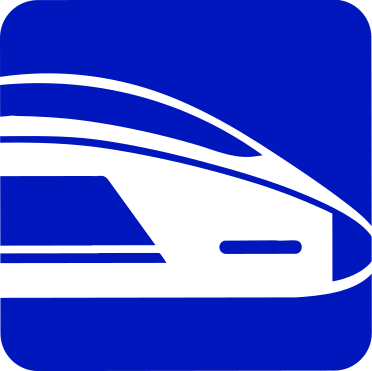
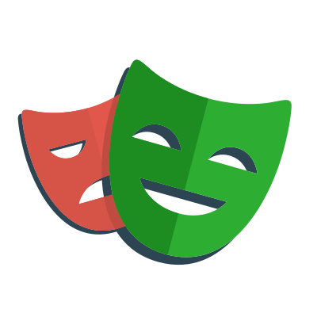
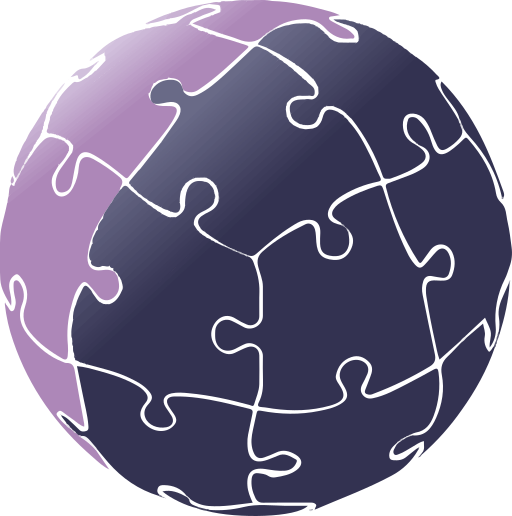

# Luca Berardinelli, PhD

PhD in Computer Science · 15+ years in research and industry

**Digital Twin Engineering** · **Model-Driven Engineering** · **Model-based, spec-driven engineering with LLM agents**

I engineer digital twins from system models: from **SysML v2** descriptions of machines and plants to
standard-compliant **Asset Administration Shells (AAS)**, and lately with LLM agents that operate the
model tool chain.

> **Featured — SysML v2 → Asset Administration Shell**
> E. Ferko, L. Berardinelli, A. Bucaioni, M. Behnam, M. Wimmer.
> [*From Engineering Models to Digital Twins: Generating AAS from SysML v2 Models*](https://doi.org/10.1016/j.jss.2025.112688),
> Journal of Systems and Software.
> A model transformation that turns SysML v2 engineering models into AAS, so that the digital twin
> is derived from the same model the engineers design with. Validated on the 24 OMG SysML v2 test models.

### Digital twin engineering
- **SysML v2 → AAS** (journal paper above), building on higher-order transformations that integrate
  SysML into AAS ([ICSA 2024](https://doi.org/10.1109/ICSA-C63560.2024.00063)).
- Federated digital twins of industrial systems (DATE 2025, multi-partner project) and
  barriers and enablers for traceability and federation in model-based digital twin engineering (IST 2026).
- Industrial use cases with Siemens (EV charging), AVL, Volvo, B&R and TGW Logistics.

### Standards I work with
| Area | Standards |
|---|---|
| Systems modeling | OMG SysML v2 / KerML, SysML v1, UML (profiles, MARTE), fUML |
| Digital twins | Asset Administration Shell (IEC 63278, IDTA specifications and submodel templates) |
| Plant engineering | AutomationML / CAEX (IEC 62714) |
| Model management | OMG MOF / Eclipse Ecore, QVT Operational, OCL, BPMN |

### International projects and proposals
- **Acquired and led JKU's participation** in two large European projects co-funded by the EU and FFG:
  - [AIDOaRt](https://cordis.europa.eu/project/id/101007350) (H2020-ECSEL, 2021–24): national coordinator for Austria,
    32 partners in 7 countries, JKU budget €594k; coordinated AVL, Dynatrace, TU Graz and AIT and the reporting to FFG.
  - [MATISSE](https://cordis.europa.eu/project/id/101140216) (HORIZON-KDT-JU, 2024–27): federated digital twins with
    SysML v2 and AAS, 30+ partners, JKU budget €397k, Siemens e-charging use case.
- Proposal writing and consortium building for European (Horizon Europe, KDT/Chips JU, ITEA) and national
  (FFG co-funding) calls, together with industrial and academic partners.
- 15+ years in international consortia: FP6 PLASTIC, ARTEMIS PRESTO and CRAFTERS, H2020 U-Test,
  MSCA ITN Lowcomote (mentoring early-stage researchers), ITEA BUMBLE and HybridDLUX, the Christian Doppler
  Laboratory CDL-MINT; research positions in Italy and Austria.

### Model-driven engineering
- 15+ years of research and industrial projects: metamodeling, DSLs, model transformations
  (QVTo, ATL, Epsilon), co-evolution, non-functional analysis, DevOps for models (DevOpsML).
- Technical lead at Braintribe (Tribefire platform).

### Model-based, spec-driven engineering with LLM agents
- **Agentic model management**: a reference architecture for MDE over the Model Context Protocol.
  A gateway federates model-management providers (ATL transformations, Epsilon EVL/EGL, model repositories) as MCP
  tools; every capability is described by a model (Ecore descriptor, validated with EVL) from which
  CLI, MCP tools and BPMN workflows are generated. LLM agents (Claude or a local model) plan and run
  transformation chains from a web workbench with a megamodel view, BPMN and run log.
- **Spec-driven development with agents**: requirements kept as a model (EARS statements with
  executable verification) that generates the agents' backlog; schema-validated task briefs as
  contracts between planning and implementation agents; every task verified by execution and
  code-reviewed before commit.
- **Agent skills for engineering**, built with **Claude Code as the agent harness** (skills, subagents,
  hooks, headless runs): natural language → SysML v2 models checked against a parser
  oracle; UML architecture views generated from a model; literature and paper workflows.
- Run on a self-hosted GenAI platform (see *Tech stack* below).
- Several of these are in preparation for publication.

### Selected publications
- [From Engineering Models to Digital Twins: Generating AAS from SysML v2 Models](https://doi.org/10.1016/j.jss.2025.112688) — Journal of Systems and Software
- [Dealing with non-functional requirements in model-driven development: A survey](https://doi.org/10.1109/TSE.2019.2904476) — IEEE Transactions on Software Engineering
- [DevOpsML: Towards modeling DevOps processes and platforms](https://doi.org/10.1145/3417990.3420203) — MODELS Companion 2020
- [Bridging MDE and AI: a systematic review of DSLs and model-driven practices in AI software systems engineering](https://doi.org/10.1007/s10270-024-01211-y) — Software and Systems Modeling, 2025
- [Cross-disciplinary engineering with AutomationML and SysML](https://doi.org/10.1515/auto-2015-0076) — at – Automatisierungstechnik, 2016
- [AIDOaRt: AI-augmented Automation for DevOps, a model-based framework for continuous development in CPS](https://doi.org/10.1016/j.micpro.2022.104672) — Microprocessors and Microsystems, 2022
- Full list: [Google Scholar](https://scholar.google.com/citations?user=r1lCltMAAAAJ)

### Tech stack

**GenAI & agents**

  &nbsp;&nbsp;
  &nbsp;&nbsp;
  <a href="https://modelcontextprotocol.io"><picture><source media="(prefers-color-scheme: dark)" srcset="icons/modelcontextprotocol-dark.svg"></picture></a>&nbsp;&nbsp;
  &nbsp;&nbsp;
  <a href="https://ollama.com"><picture><source media="(prefers-color-scheme: dark)" srcset="icons/ollama-dark.svg"></picture></a>&nbsp;&nbsp;
  &nbsp;&nbsp;
  <a href="https://notebooklm.google"><picture><source media="(prefers-color-scheme: dark)" srcset="icons/notebooklm-dark.svg"></picture></a>&nbsp;&nbsp;
  &nbsp;&nbsp;

**LLMOps & platform**

  &nbsp;&nbsp;
  &nbsp;&nbsp;
  &nbsp;&nbsp;
  &nbsp;&nbsp;
  &nbsp;&nbsp;
  &nbsp;&nbsp;
  &nbsp;&nbsp;
  &nbsp;&nbsp;
  &nbsp;&nbsp;

**IDEs**

  &nbsp;&nbsp;
  <a href="https://theia-ide.org"><picture><source media="(prefers-color-scheme: dark)" srcset="icons/theia-dark.svg"></picture></a>&nbsp;&nbsp;
  <a href="https://eclipseide.org"><picture><source media="(prefers-color-scheme: dark)" srcset="icons/eclipseide-dark.svg"></picture></a>&nbsp;&nbsp;

**Modeling & digital twins**

  &nbsp;&nbsp;
  <a href="https://eclipse.dev/basyx/"><picture><source media="(prefers-color-scheme: dark)" srcset="icons/basyx-dark.svg"></picture></a>&nbsp;&nbsp;
  &nbsp;&nbsp;
  &nbsp;&nbsp;
  &nbsp;&nbsp;
  &nbsp;&nbsp;

Open to R&D roles, consulting and research collaborations — [LinkedIn](https://www.linkedin.com/in/lucaberardinelli/).
